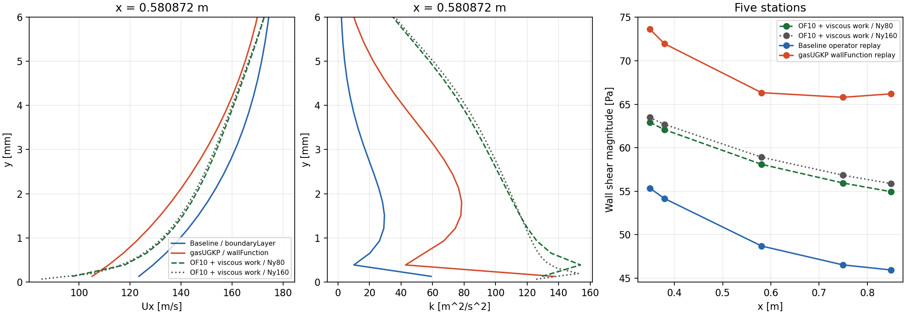

# 独立参考补充：不能把旧baseline当作准确答案

本轮执行跨2026-10-19/20午夜。仍针对f9e8d775计算源码、两份已经上传的真实保存场；没有修改ugkp-thermal生产代码，也没有改动原生产算例。

**现有证据更支持wallFunction的近壁速度和k；并不支持“与baseline差大，所以wallFunction算错”。剪切则是baseline偏低、wallFunction偏高，不能在所有站位统一给后者排第一。两套gasUGKP结果仍都受明显的空间离散耗散影响。** 这是一项有条件的数值判断，不是实验真值认证，尤其不能推广为所有温度、压力、热流都已判定正确。

## 参考计算如何构造

用独立安装的OpenFOAM10 `rhoSimpleFoam`，纯空气、SST、相同域、相同粗网格、相同入口/顶部U/T/p/k/omega、相同墙温、黏度、Cp、Pr和Prt；无吹气。采用OF10原生Spalding、omegaWallFunction和Jayatilleke热壁函数。以块网格Ny=80和160分别计算，x方向保持96+192+48，不把网格加密的不同首层位置直接相比。

速度/能量对流采用linearUpwind，k/omega采用upwind，SIMPLE迭代；因此这是一项不同离散方法的交叉检查。它不是ugkp-thermal的完整制造解，更不是两者所有方程、边界及暂态历程完全等价的证明。

标准rhoSimpleFoam能量方程没有显式黏性功输运。本轮额外复制其源码到test隔离目录，只在EEqn左侧增加 `fvc::div(turbulence->devTau() & U)`，检验这项能量差异是否改变动量结论。OF10的devTau为负黏性应力，所以这里对应总能量中的−div(τ·U)。并未替换系统rhoSimpleFoam或任何生产二进制。

四个计算全部正常退出并满足设置的SIMPLE初始残差阈值1e-8：

| 计算 | Ny | 收敛迭代 | 求解退出码 |
|---|---:|---:|---:|
| 原生OF10 | 80 | 714 | 0 |
| 原生OF10 | 160 | 1585 | 0 |
| 加入黏性功对照 | 80 | 722 | 0 |
| 加入黏性功对照 | 160 | 1613 | 0 |

两张网格checkMesh均为Mesh OK，退出0；黏性功对照完整编译/链接成功。最终时间的wallShearStress/yPlus后处理四次均退出0。初次缺wallDist字典、初次缺新增通量div格式的配置失败日志照实保留，没有记为通过；修正仅作用于参考算例配置。

## 具体结果

在x=0.580872 m、原网格第一层中心y=0.127389 mm：

| 量 | 旧baseline | 当前wallFunction | OF10加黏性功，同网格 |
|---|---:|---:|---:|
| Ux，m/s | 123.4812 | 105.1177 | 97.2617 |
| k，m²/s² | 59.1271 | 137.0350 | 129.4685 |
| 壁面剪切幅值，Pa | 48.6825 | 66.3282 | 58.0820 |

前两列的剪切由真实壁面算子对对应保存场重放取得，参考列由OF10最终场实际后处理取得。不是拿同一输入下替换模型的结果冒充两条已推进轨迹。

参考Ny=160的同站壁面剪切58.9020 Pa，比Ny=80高约1.41%；其自身第一层中心y=0.0638824 mm，所以不能直接拿该层Ux=85.1923与原第一层相比。对参考剖面在原y位置线性插值，Ux约95.0919 m/s。该插值仍有误差，不能当作精确点值，但不足以把旧baseline的123.5解释为与参考一致。

加入黏性功在粗网格该站使Ux从97.3765变成97.2617，剪切从58.1983变成58.0820，约0.2%变化。参考温度则变化数K，故不能省略热方程差别后宣称温度已验证。

五站同网格首层速度均为wallFunction更接近这项独立参考。与加黏性功的同网格参考相比，全域非体积加权向量速度RMS：baseline约4.6047 m/s、wallFunction约3.2097 m/s；k RMS约37.0631和23.6902。这里U使用sqrt(mean(|ΔU|²))，不是三分量再平均。压力RMS反而baseline更小，不能把速度结论扩展到全部场。完整数值见comparison.json/stations.csv/profiles.csv。



## 与已定位机制如何对应

1. 两套gasUGKP在首个法向内部面均有很强声学数值动量输运；同站约47.38/59.68 Pa，物理黏性和湍黏性项仅2.33/8.28 Pa。制造动量剖面的已知1 Pa应力被粗网格通量算成117.10 Pa，加密后收敛至1.029 Pa。这已经证明一项通用离散精度问题，不是只看两个场差异推测。
2. 这种输运会改变宏观速度梯度，进而改变SST产生项、k和nut，并向壁面模型反馈。旧BVP内部剖面在owner高度的Ux约83.18 m/s，宏观同高度为123.48；按该内部剖面对第一层整个盒子分段线性作密度加权平均，约77.30 m/s，也不能单用“点值与体积平均值不同”解释。不能用“壁层Newton收敛”证明宏观/细剖面耦合准确。该失配与粗网格闭合及匹配方式有关，仍需通用一致性修正验证。
3. 局部wallFunction的Spalding根、omega和产生项已被真实输入重放核验，未发现足以解释此量级差异的公式执行错误。两种处理不等价是事实，但单凭“不等价”不足以解释并接受如此大的场差。
4. 全网格生产算子单次Euler重放，质量/三动量/总能量库存与边界通量闭合约1.5e-14；不支持当前重放有大规模漏账。此结论不等于两次原长算所有RK历史的完整守恒审计。

因此，目前应优先修正/验证**近壁通量与重构精度，以及BVP细剖面和宏观有限体积状态的一致匹配**，不能靠把wallFunction调到旧baseline来验收，也不应通过案例专用系数抵消数值误差。

## 尚不能作出的结论

- 没有找到本地同条件M0.55无吹气的独立实验真值；现有数据集中M1.8/2.5/3.6无吹气和M0.55有吹气数据不能替代。
- 参考是稳态解，gasUGKP比较时刻是t=0.018 s；虽局部速度变化已经很小，但未据此证明整个暂态已严格收敛。
- 只做法向一倍加密，没有完成二维网格极限/低Re SST全域解析参考；两个OF10参考也不能认证自身全域网格无关。
- 热壁函数、能量离散、有限体积/点值语义仍有差别；不能由本轮参考断言全部热流、温度的正确排序。omega代数行随首层网格位置变化，也不适合直接跨网格当作同一点物理量对比。
- HLLC等接触分辨通量的单气体核心能消除此类静止剪切耗散，但当前生产混合气HLLC消费路径未实现，不能直接切换参数，更不能删除MissingOperator后让零通量继续。

## 复查与复现

`reference/raw-reference.tar.gz`仅包含四套参考的最小输入字典/初场和完整原始日志，不上传这些参考的全部场。四组生产场快照包保持原样。raw-manifest逐成员校验通过；identities.json记录输入、最终场、编译产物和源码哈希。参考原始全场保留在test隔离目录，未清理。

在解压本PR两份快照之后：

```sh
python3 tools/reproduce_of10_reference.py --snapshots /absolute/unpacked --out /absolute/new-reference --openfoam /opt/openfoam10
python3 tools/compare_of10_reference.py --reference /absolute/new-reference --snapshots /absolute/unpacked --out /absolute/new-comparison
```

便携入口的`--prepare-only`已运行退出0，28份输入与实际运行输入逐项检查相同词法内容，只有两份fvSchemes的wallDist空白排版不同。便携比较入口也已实际执行退出0，三个输出文件与原比较脚本逐字节一致。完整四次计算、构建和最终后处理是上述原执行脚本实际完成的；没有声称把整个便携求解入口重新长跑了一遍。精确执行脚本、命令、退出码和初始配置错误均在reference目录/压缩日志内。

正式库、原两份生产数据和已有生产二进制保持现状。本PR仍只交付证据/工具，不含生产数值修复；不应因这些证据上传而宣称生产精度问题已解决。
