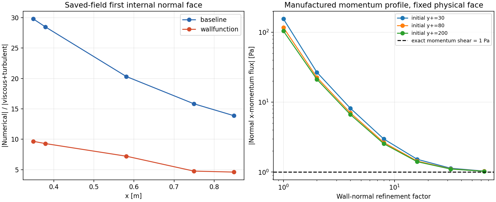

# 进一步诊断：近壁动量输运由数值耗散主导

后续补充：已完成独立OF10同网格/法向加密及黏性功敏感性对照，见[独立参考与判断边界](独立参考与判断边界.md)。它支持wallFunction的近壁速度/k更接近该参考，但不认证完整物理真值。

## 当前可以明确回答的部分

**本轮已经查明一条实质原因：Kurganov + MUSCL/Barth–Jespersen 在当前非线性近壁剖面上的声学数值耗散，压过了物理黏性/湍黏性动量输运。** 此误差同时存在于两套结果；不能再只归因于“两个壁面模型不同”。

这不是“壁函数y+不合格”的判断。宏观网格满足壁函数常用的y+条件，与整个数值通量/重构在该网格上是否足够准确，是两项不同要求。

已有证据不支持把主要问题归为本轮重放路径的质量/动量/总能量漏账，也没有发现壁函数根解算错造成该量级差异的证据。**数值函数按当前公式计算正确，离散近似仍可以有很大误差。** 本轮已用已知应力的通用剖面将这种误差检出，并观察到加密后收敛。

**哪一份完整ARC3696结果更接近真实物理，目前仍不能选定。** 两份场都含有显著的数值动量输运；旧版一致性验收不能替代独立物理准确性验证。本轮没有给其中任何一份作“整体正确”的背书，也没有把局部机制当作全部场误差的精确百分比归因。

## 1. 同一真实保存场的生产通量分解

使用选定包中t=0.018 s的完整场、网格和边界输入，在CPU宿主适配器中调用未修改的生产梯度、限制器、混合气重构、面通量、黏性通量和单元更新函数。不是手写替代方程，也不是CUDA运行。全部26880单元、107936面实际参与，fatal=0。几何重构体积与保存0/V相对差小于1e-10；重新计算的nut与保存nut最大相对差分别约2.74e-6和3.54e-9。

在x=0.580872 m、第一/第二层内部面y=0.254777 mm，单位面积x动量通量为：

| 分量，Pa | baseline | wallFunction |
|---|---:|---:|
| 对流加权项 | +3.81111 | +2.55338 |
| Kurganov数值耗散项 | −47.38374 | −59.67985 |
| 物理黏性＋湍黏性项 | −2.33138 | −8.27943 |
| 合计 | −45.90402 | −65.40590 |

数值项/物理黏性项的幅值比约 **20.3** 和 **7.21**。这并非壁面τ的第二种定义：这里严格指该内部面上的守恒动量通量分量，数值项包含密度/动量跳跃的耦合贡献。两者都不能当作已分辨的物理剪切应力。

MUSCL重构后的左右Ux分别为126.22370/126.39868 m/s和108.30546/108.53002 m/s，仅约0.175/0.225 m/s的跳跃就通过声速尺度形成了上述大数值通量。首层Ux限制器分别约0.0883和0.1196。并非把未重构的整段速度差直接塞给通量。

调用真实HLL组分代数分解后，数值项＋对流项与完整无黏性通量最大绝对差约1.4e-14 Pa；物理项通过同一面算子关闭μ、湍流和分子扩散的固定状态对照取得。没有推进物理时间或搜索候选后挑结果。

该点单步重放dU/dt约−0.448和−0.547 m/s²，与巨大通量的近乎平衡并存。它支持“已经接近受离散耗散影响的平衡”，不能把继续同样长算视为消除空间误差的手段。

完整五站及原始逐面结果见 `numerics/results-summary.json` 和 `numerics/raw-numerics.tar.gz`。

## 2. 守恒核验的范围与结果

恢复完整面通量后，直接调用生产applyGasFluxDivergenceByCellKernel，做dt=1e-7的单次Euler输运更新，逐单元实际累计更新前后库存；另独立累计边界面通量。每个内部面由相邻两单元异号使用。

质量、三分量动量和总能量的 `实际库存变化 − dt×边界净输入`，按绝对边界输运规模归一化后的最大误差约 **1.53e-14**，符合浮点舍入量级。

因此本轮实际重放路径没有出现足以解释场差异的守恒漏项。**这不是对原两条长算全部RK历史的逐步守恒审计**：原每个RK阶段的状态/通量没有保存。k和omega具有模型源项及代数约束，也不能用“全域库存不变”来判其守恒。

## 3. 有已知正确应力的通用分辨率检查

为独立区分“算子公式算错”与“离散误差”，构造一维Spalding光滑速度剖面，并给定与之相容的有效黏度，使 `rho*nu_eff*dU/dy = 1 Pa` 在整个域内成立。粗网格首层目标y+取30、80、200；使用真实生产梯度、限制器和输运算子。

**此测试是动量输运制造剖面，不是完整SST/能量方程的精确制造解。** 涡黏度为已知系数，未声称该剖面同时满足SST源项。单元速度以Gauss积分的单元平均给出。加密时保持物理域和比较面位置不变。

以初始首层y+=80为例：

| 法向单元数 | 完整数值动量通量幅值，Pa | 其中物理黏性项幅值，Pa | 其中数值耗散幅值，Pa |
|---:|---:|---:|---:|
| 16 | 117.0994 | 1.53571 | 115.5637 |
| 64 | 7.04918 | 1.01205 | 6.03713 |
| 128 | 2.65352 | 1.00295 | 1.65057 |
| 512 | 1.11243 | 1.00018 | 0.11225 |
| 1024 | 1.02855 | 1.00005 | 0.02851 |

21组剖面加密测试均完成。三种粗网格y+下均呈类似趋势。**这些单元数不是对实际ARC网格的推荐**，它们用来证明已知剖面上的离散误差及其收敛趋势。

另做同一粗网格的正/反向线性剪切对照，指定常有效黏度、真实应力1 Pa；最大通量误差约6.2e-13 Pa，数值项约6.2e-13 Pa。这排除了把通量拆分、几何、符号或量纲的固定错误误当作大耗散的解释。



## 4. 静止剪切接触与实现限制

81组Euler静止剪切接触：左右rho/p相同、法向速度均为0、切向速度不同。其精确Euler切向动量通量为0。

真实Kurganov核心返回 `−a*rho*DeltaU/2`，与当前算法公式相符；真实HLLC/SLAU2常gamma核心返回0。gamma、rho、切向Mach和跳跃幅度均有扫描。这说明大耗散是当前近似通量的剪切分辨能力，不是计算机把该公式算错。

真实ARC重构状态的常gamma核心对照在同站给出HLLC约+3.80781/+2.55064 Pa，与对流项接近，未带有Kurganov的−47/−60 Pa额外输运。这里利用无吹气案例几乎纯Air、常Cp的条件，只作核心诊断。

**当前混合气生产消费路径只支持Tadmor/Kurganov。** 真实调用HLLC会在site10042返回MissingOperator；已经单独复现并保留日志。不能将常gamma核心结果宣称为已实现的混合气HLLC，也不能只改配置就当作修复。该缺失算子不是当前Kurganov计算差异的触发错误。

## 5. 对两种壁面处理应如何判断

壁函数在当前网格的y+条件成立。壁层BVP重放也满足自己的残差判据；内部24→128节点的剪切变化不足以解释当前主要差距。这些证据分别说明局部模型可计算，不等于全局离散场已达到足够准确度。

baseline辅助剖面的owner点Ux约83.18 m/s，粗网格owner为123.48 m/s。将辅助剖面点状态送入壁函数，得到剪切约44.61 Pa，比壁层48.68 Pa低约8.4%；将实际粗网格owner状态送入同一壁函数，却得到87.28 Pa、高约79.3%。所以不能把“壁函数本身必然产生更强阻力”作为普遍结论；**输入状态及粗细耦合改变了差异，且本轮已定位到粗网格内大量数值动量输运。**

当前最具体的错误类型是近壁输运的离散精度/耦合不足。尚未证明两个局部数学算子之一存在足以解释全部差异的算术或方程实现错误；也没有独立真解可将当前完整ARC两份结果排出物理正确性先后。本地参考包中的零吹气实测覆盖M1.8/2.5/3.6，不含同条件M0.55；M0.55现有表是有吹气结果，不能拿来直接裁定本次无吹气两场。

## 6. 有依据的处理方向

1. 优先解决共享气相通量对近壁切向变化的数值耗散/重构兼容性。可评估通用混合气接触/剪切分辨通量；必须一致处理EOS、形成能、组分守恒、波速与错误传播，不能冻结混合气密度/gamma、绕过MissingOperator或针对M0.55调系数。
2. 同时检查wall-model辅助剖面与粗网格重构、梯度和体积状态之间的离散匹配。当前壁面通量替换与内部面的高声学耗散会形成不同的数值平衡，单独统一某个Pk表达式不能保证修复。
3. 修复后用上述制造剖面、静止接触、多组分接触及独立空间收敛验证，再在两模型上使用相同输入作端到端对照。工程物理正确性另需同条件参考解/数据；不能靠相互拟合两个当前结果。

本轮仅发布原因诊断、输入、脚本和原始结果；没有修改生产代码、正式库、原案例或启动生产长算。

## 7. 复现与证据边界

解压前述四时间快照后，执行：

```bash
python3 docs/diagnostics/arc3696-wallmodel-audit-20261019/tools/reproduce_numerics.py   --source /path/to/ugkp-thermal   --snapshots /path/to/arc3696-selected   --out /path/to/new-isolated-output
```

依赖Python3、numpy、g++；输出目录必须是新目录。此入口已经在本轮上传压缩包的实际解压副本上完整运行，退出0。完整命令、源/诊断程序哈希和原始结果均随本目录发布。所有检查明确为CPU宿主执行生产算子，不能替代GPU race/sync或原始长算的完整时间历史复现。
