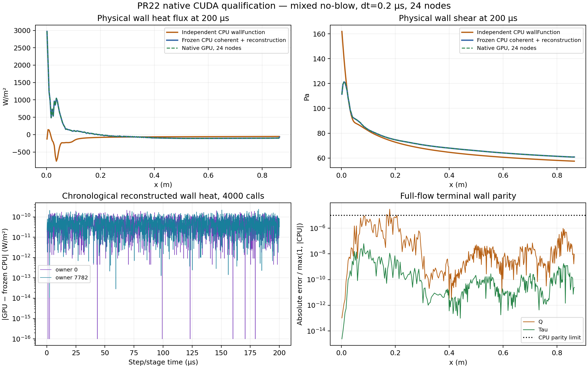

# PR22 原生 CUDA / GPU 验收 — 2026-10-22

**24节点原残差判据、一步守恒及设备运行检查通过；200µs逐点1e-5一致性结论：未通过。** 与独立演化 wallFunction 的入口热流差异仍明显，不能声称普遍热流吻合或达到稳态。PR22保持草稿，不合并。

基线 `2e3a1b1b25803ccc9746a8c53734d01a631a876f`；分支 `fix/reacting-sst-coupling-20261020`。计算源、命令、二进制和原始数据都有哈希清单。未修改方程、物理容差、dt、Newton预算，也未调系数贴合wallFunction。

## 环境、构建与修复

WSL Ubuntu22.04 / OpenFOAM10 / g++11.4.0 / CUDA13.1.115 / RTX4060 Laptop GPU 8GiB / sm_89。Windows16GiB，WSL约11.6GiB RAM；完整硬件/驱动信息见证据environment.txt。最终完整构建为 nvcc `-O3 --fmad=false --expt-relaxed-constexpr -arch=sm_89`，`NVCC_APPEND_FLAGS=-Ofc=mid -v -Xptxas=-v`，线程栈131072 bytes。整构建1:11.09（m:ss），峰值RSS1045500KiB。本次验收采用该实际配置，未把未完成的默认全优化构建当成成功结果。

修复三处问题：

1. GasConservativeMatching首次在匿名算子命名空间内包含导致第二套ugkwp类型；改为公共依赖入口全局包含，原生编译回归通过。
2. 生产脚本缺少独立驱动已有的`--expt-relaxed-constexpr`。警告直接涉及闭合/残差中的host constexpr调用；旧构建336墙首次coherent刷新均失败。相同临时诊断源码、FMA和快速编译下，只补该选项即使Euler通过。临时数学诊断全部撤掉。
3. 快速编译分离设备调用后，默认栈在物性反演链溢出，memcheck明确报告Stack overflow。增加可选且严格校验的`GAS_UGKP_CUDA_STACK_BYTES`，显式请求时只增大limit并打印实际值；unset保持默认。

默认优化及汇编器单独降成本的中间尝试曾OOM或被人工停止，日志保留。12GiB临时工作区交换文件已swapoff并删除，原交换配置保留，未修改持久系统配置。最终mid构建和正式运行均在清理后完成。Ofc=max中间档运行很慢，被中止的10/20步不记作通过。

输入准备器修正模板继承的latestTime和自适应dt。最初4µs实为9步的对照已标无效并保留。最终使用startFrom=startTime、adjustTimeStep=false、dt=2e-7s、SSPRK2、24节点、maxIterations=60，比较器核验实际每步dt/time、总步数和求解数；FP64时钟累加仅按记录的舍入尺度检查，不放宽逐步dt。

## 独立参考与原生算子

原CPU归档SHA256 `505cc2aa4ebca0e637222d3311d6be3880c3b3e7dcf071400319520f437fb2d1`，748原文件校验通过，另独立读取全部672000个CPU根记录。交付CPU可执行文件需要本机没有的新版GLIBC/libstdc++，因此先验证原包，再从未修改的原包源码重建20步及1000步参考；原包及重建二进制哈希单独保留。

原生测试通过11剖面、捕获723的3个solver模式、6个legacy控制，以及owners0/7782各2000次连续调用，共4000次完整solve/profile/source GPU回放，直接比较独立冻结final-A.csv及当前标量结果。算子驱动为-O3/fmad=false；最终整应用为fmad=false/mid，作用域分开记录。

4000次回放最大真实残差1.009916e-08（原限值1.01e-8），最大矩残差2.2759572e-15；重构热流/剪切最大绝对差2.3911184e-10W/m² / 2.8052227e-11Pa。每个owner全部2000记录都有非零重构内面物种输运，最大|J|=0.08228897；壁面输出wallJ严格零，物种扩散通量之和最大1.110223e-16。

profile/coherent/legacy/sequence四组各自memcheck、racecheck、synccheck共12次通过；序列sanitizer每墙取连续4次，覆盖冷/热状态。最终mid整应用另外进行三种sanitizer的一步Euler控制，均退出0、无报告错误；不把有界检查称为全长sanitizer。

## 全场一致性

336墙、336个两单元守恒列，共672个单元，固定dt=0.2µs；所有墙纳入，没有剔除入口。

| 运行 | 实测根数 | 失败/回退 | 累计最大真实残差 | 末阶段最大矩残差 |
|---|---:|---:|---:|---:|
| 20步/4µs | 13440 | 0/0 | 1.0089122e-08 | 1.2212453e-15 |
| 1000步/200µs | 672000 | 0/0 | 1.0099985e-08 | 5.9396932e-15 |

残差最大值和失败计数跨整轨迹累计；矩残差来自末阶段，未声称独立导出了所有672000次设备矩记录。场/壁通量采用`abs(GPU-CPU)/max(1,abs(CPU))<=1e-5`，同时报告绝对差及相对L2。200µs的17个场：

| 场 | 最大绝对差 | 最大归一化差，分母下限1 |
|---|---:|---:|
| rho | 9.7433749e-08 | 5.940828e-08 |
| rhoE | 0.02394462 | 6.9450897e-08 |
| p | 0.0089080707 | 7.1915884e-08 |
| k | 2.5379622e-05 | 2.6517094e-07 |
| omega | 0.027547557 | 1.5991766e-07 |
| nut | 3.1397318e-10 | 3.1397318e-10 |
| Tgas | 3.5906587e-06 | 1.2848331e-08 |
| Ux | 1.5580556e-05 | 9.7627078e-08 |
| rhoUx | 2.6372415e-05 | 1.0073003e-07 |
| Uy | 2.1811137e-05 | 2.1811137e-05 |
| rhoUy | 3.568849e-05 | 2.5451567e-05 |
| Uz | 4.8121853e-09 | 4.8121853e-09 |
| rhoUz | 7.9517966e-09 | 7.9517966e-09 |
| speciesRhoAir | 8.0931924e-08 | 5.9771212e-08 |
| speciesRhoCO2 | 1.6501827e-08 | 1.6501827e-08 |
| rhoK | 4.6401572e-05 | 2.6620477e-07 |
| rhoOmega | 0.046068858 | 1.630206e-07 |

4µs重构后壁面热流/剪切最大绝对差为4.5081905e-09W/m² / 7.5601747e-12Pa；200µs为0.00118728W/m² / 5.2943581e-06Pa。使用实际发布的wall-work.csv:diffusiveEnergy/tractionX，没有把原始BVP热流混作最终耦合热流。200µs物种密度闭合最大误差6.2172489e-15；rho/p/T/omega正、k/物种密度非负。

墙质量通量严格零；个别face物种通量有几何切向投影舍入量，最大7.8840565e-26kg/s，两物种逐面严格对消。每种幅值按64*FP64 epsilon*最大采样内部面物种通量的舍入尺度验收，本次界限7.2874696e-20kg/s；该规则不改变物理solver容差。含略高于界限的泄漏拒绝测试；独立BVP wallJ精确零检查保持。

## 守恒与回归

最终mid二进制一步Euler，用实际GPU面通量及源数组独立重建库存变化：

| 通道 | 最大单元库存缺陷 | 全域库存缺陷之和 |
|---|---:|---:|
| mass | 8.6212273e-24 | -3.569397e-21 |
| momentumX | 1.5646711e-21 | -6.4165885e-19 |
| momentumY | 2.5849394e-23 | -1.4201534e-21 |
| momentumZ | 2.2343797e-34 | -1.9895968e-34 |
| energy | 2.1875235e-18 | -6.3234437e-16 |
| rhoK | 1.1428854e-22 | -1.1507161e-20 |
| rhoOmega | 8.8091427e-20 | -6.0364984e-18 |
| speciesAir | 7.0036931e-24 | -3.0081889e-21 |
| speciesCO2 | 1.3646031e-24 | -3.9233357e-22 |

rhoOmega排除336个wall-owner代数omega约束，其余单元纳入。单元/全域缺陷均满足1e-12*max(1,|预测全域改变量|)。这是独立一步审计；长算终态一致性不替代全时段独立积分预算。原始日志仍保留historical conservation residual警告；FMA0基线223条代表样本行的observed/reference最大差6.42e-22，并非223个独立守恒失败。独立审计结果与日志样本统计分别保存。

定向测试**27通过**。覆盖原生编译、共享路由/存储/数值组件，以及NaN后置行、物种闭合、错误步长、时钟累加及舍入界限反例。旧标量固定值在原提交的g++11上同样有约1e-14舍入差，现采用1e-12有限值比较（state分母下限1e-8），保留原物理判据、精确迭代/F/J及网格断言。全库扫描曾因本地导入/伴随算例路径有55个收集错误；不声称全库全绿，原日志保留。

## 长程差异诊断

关闭FMA没有消除逐点超限，FMA开/关两组均保留；原始失败不被成功局部回放覆盖。另用完全未修改的冻结CPU源码在本机重算1000步，逐检查点与原归档对照：1000步的17场最大归一差5.8364347e-06，墙热流最大归一差1.9002822e-06，均低于1e-5。本机CPU的672000根及全程库存预算独立审计通过；GPU对本机CPU仍有超限，不能把全部GPU漂移归因系统库。CPU/GPU也存在数学等价的FV求值顺序差异：冻结为q+A*(adv+diff)-b，原生产为q-b+A*(adv+diff)；组分焓通量有先除/后乘面积与积分通量直接修正的差别。独立对齐试验未改变方程、几何、dt或容差；1000步仍有7个场点和3个墙热流点超限，最大场归一差2.24584e-5、热流3.08787e-5，没有修复严格parity，故已撤回，最终生产代码保留原来的组装顺序。在冻结CPU第1步第1阶段的匹配输入上单独审计算术顺序：1008面中528面的法向动量通量出现非零差，最大5.55e-17；由dt*ΔRHS估计的rhoUy/能量扰动分别4.24e-14/9.05e-14，尚未计后续limiter、更新舍入和热物性恢复，并非实际执行两套Euler更新测得的状态差。1步SSPRK2（两个stage）被动审计与未插桩控制的17终态场及672根记录逐位相同。该证据限定算术舍入，不等价于证明1000步偏差全部由此产生。最终详细指标见summary.json中experiments，各试验保留原始命令、源码和差异统计。不能仅凭观察把长程漂移归因于libm或CUDA。

200µs有11个场数据点、3个墙热流点超过1e-5；各场有26880单元，墙数336。墙热流最大归一差3.0140254e-05，最坏归一位置索引46；最大绝对差位置索引21另列，避免混淆。此门槛为本轮新增的宏观比较标准，并非原非线性收敛容差。

## wallFunction吻合程度

与独立演化到200µs的冻结CPU wallFunction比较全部336墙：热流面积MAE **153.26602W/m²**，剪切面积MAE **3.3365636Pa**，47面热流异号。剪切面积绝对误差/绝对参考剪切为4.8579752%。入口owner0热流GPU 2970.3121 对wallFunction -126.84332W/m²。

绝对热差/导热、恢复和牵引功绝对活动量为2.1585469%，**不是净热流相对误差**。该差异与冻结CPU一致，没有调参或删墙消除；独立演化的有限瞬态窗口不证明稳态或普遍壁面律等价。

## 效率

本任务串行计时，期间不并发其他测试或编译；笔记本桌面进程及功耗调度未作系统隔离。最终GPU20步中位耗时（剔除前两步）**0.74548454s/步**；原包标量诊断驱动相同20步为**1.1035296s/步**。CPU包含被动失败捕获复制及大量CSV，和GPU I/O不同；这是端到端观测，不据此宣称相同算子的CPU→GPU加速比。

336固定输入profile-only CUDA event计时，每模式预热一次、连续三次计时取均值，单lane与warp32有结果一致性检查：

| 输入 | 节点 | 单lane ms | warp32 ms | 比值 |
|---|---:|---:|---:|---:|
| pure | 24 | 530.54877 | 367.30676 | 1.4444296× |
| mixed | 24 | 560.57513 | 366.14822 | 1.531006× |
| pure | 128 | 3376.2874 | 2355.2825 | 1.4334957× |
| mixed | 128 | 3483.1692 | 2402.4692 | 1.4498288× |

mixed项为含组分输运，pure分开标注。这是固定输入重构，不含完整非线性BVP/FV/通信/I/O。4000次逐墙回放的230.71951s含启动/managed-memory开销，不作为吞吐加速比。设备时钟、温度、功率、每步事件及原始时间见JSON/日志。

## 证据与边界

[复现命令](REPRODUCE.md) · [汇总JSON](summary.json) · [逐文件清单](evidence-manifest.json)。归档265,652,679bytes、2174文件、13个20MiB分片（末片可更小），SHA256 `cfac943e48a3eff17cf9501a686c38a570469c0fbdf4ffe10940c10744f5e317`；重组后逐文件复核通过。包含成功、失败、中止日志、环境、命令、CPU/GPU差异、预算数组、最终场及源码/二进制哈希；不重复可执行文件、swap、PTX和原CPU参考包。

资格范围为冻结二组分、相等正扩散系数、无喷出、规则两单元棱柱列。不扩张为一般反应/吹气/任意几何或任意纯匹配端点。PR保持草稿，不合并。
